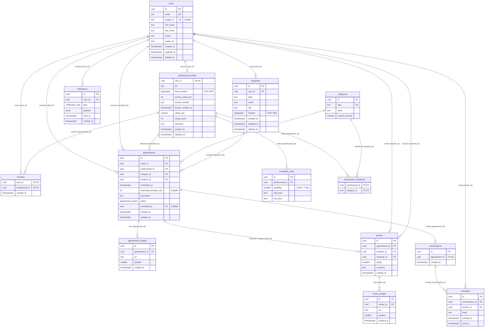

# Database

PostgreSQL + PostGIS, managed with Prisma migrations. Once `apps/api/prisma/schema.prisma` exists it is the source of truth for columns and types; this document explains the **why**, the rules the schema can't express, and the indexes.

## Entity-relationship diagram

## Tables

### users
Every person in the system. `google_id` is nullable so other login methods can be added without schema changes. Soft deleted with `deleted_at`.

### properties
Addresses of a client where jobs happen. The address entered during onboarding becomes the first property. Soft deleted so old appointments keep pointing to a valid row (`BR-11`).

### professional_profiles
1:1 with `users`; its primary key **is** `user_id`, so "professional id" and "user id" are the same value. `rating_avg` and `rating_count` are denormalized and updated in the same transaction that inserts a review. `timezone` defaults to `America/Argentina/Buenos_Aires`. `license_verified_at` not null ⇒ show the check badge.

### categories / professional_categories
N:M between professionals and categories. `requires_license = true` for gas fitters (`BR-10`). Seeded: gas fitter, plumber, electrician, painter, carpenter, roofer.

When a professional stops offering a category, its `professional_categories` row is deleted. Past appointments are not affected because `appointments.category_id` references `categories`, not `professional_categories`. Offering the category again just inserts the row back.

### availability_rules
One row per time range per weekday (`BR-06`). Default rows created with the profile: weekdays 1–5, 08:00–16:00 (`BR-05`). Split shifts = two rows on the same weekday. The default lives as a constant in `@sm/shared`, not as a DB default. Future: `availability_exceptions (professional_id, date, start_time NULL, end_time NULL)` for holidays.

### appointments
`status` enum: `pending | accepted | rejected | cancelled | completed` (transitions in `BR-03`). `cancelled_by` records who cancelled. `category_id` is required and records which service was requested, since a professional can offer several categories. On creation the service checks that the professional currently offers that category; afterwards the appointment keeps it even if the professional stops offering it.

### appointment_images / review_images
Max 3 per parent (`BR-07`), validated in the service. `position` keeps order and is unique per parent.

### reviews
`reviewer_id` and `reviewee_id` both reference `users.id`. The backend computes `reviewee_id` as "the other participant" (`BR-08`).

### conversations / messages
One conversation per appointment, created when it is accepted (`BR-09`).

### favorites
Composite PK `(user_id, professional_id)`.

### notifications
`type` is an enum; `payload` (`jsonb`) holds the data that differs per type. Its shape is validated in code with a Zod discriminated union in `@sm/shared`. Rule: what is filtered or sorted goes in columns; what is only displayed goes in `payload`.

## Constraints not expressible in Prisma

Added by hand in the migration SQL.

| Table | Constraint |
|---|---|
| availability_rules | `CHECK (start_time < end_time)` |
| availability_rules | `CHECK (weekday BETWEEN 1 AND 7)` |
| appointments | `CHECK (client_id <> professional_id)` (`BR-02`) |
| reviews | `CHECK (rating BETWEEN 1 AND 5)` |
| reviews | `CHECK (reviewer_id <> reviewee_id)` |
| appointment_images, review_images | `CHECK (position BETWEEN 1 AND 3)` |
| — | `CREATE EXTENSION IF NOT EXISTS postgis;` |

Validated in services (not in the database): availability overlap within the same weekday, status transitions, max 3 images, review eligibility, appointment category offered by the professional at creation time.

## Foreign key behavior on delete

| Behavior | Tables |
|---|---|
| `CASCADE` | availability_rules, professional_categories, appointment_images, review_images, messages, favorites, notifications |
| `RESTRICT` | appointments (all FKs), reviews (all FKs), conversations |

Users and properties are soft deleted, so `RESTRICT` never blocks normal use.

## Indexes

PK and UNIQUE constraints create their index automatically. **Postgres does not index foreign keys by itself**, so FKs that are queried or use `RESTRICT` get an explicit index.

| Table | Kind | Columns | Type | Purpose | Declared in |
|---|---|---|---|---|---|
| users | PK | `id` | btree | — | auto |
| users | UNIQUE | `email` | btree | Login, no duplicates | `@unique` |
| users | UNIQUE | `google_id` | btree | Google login (allows NULLs) | `@unique` |
| properties | PK | `id` | btree | — | auto |
| properties | INDEX | `user_id` | btree | "My addresses" | `@@index` |
| properties | INDEX | `location` | GIST | Geo queries | migration SQL |
| professional_profiles | PK | `user_id` | btree | — | auto |
| professional_profiles | INDEX | `base_location` | GIST | Proximity search (`ST_DWithin`) | migration SQL |
| professional_profiles | INDEX | `rating_avg DESC` | btree | Sort/filter by rating | `@@index` |
| categories | PK | `id` | btree | — | auto |
| categories | UNIQUE | `slug` | btree | URLs and filters | `@unique` |
| professional_categories | PK | `(professional_id, category_id)` | btree | Categories of a professional | auto |
| professional_categories | INDEX | `category_id` | btree | Professionals in a category | `@@index` |
| availability_rules | PK | `id` | btree | — | auto |
| availability_rules | INDEX | `(professional_id, weekday)` | btree | Schedule of a professional / a day | `@@index` |
| appointments | PK | `id` | btree | — | auto |
| appointments | INDEX | `(professional_id, status, scheduled_at)` | btree | Pending jobs, agenda, recent jobs | `@@index` |
| appointments | INDEX | `(client_id, status, scheduled_at)` | btree | Client's appointments | `@@index` |
| appointments | INDEX | `property_id` | btree | FK with RESTRICT | `@@index` |
| appointments | INDEX | `category_id` | btree | FK with RESTRICT, stats | `@@index` |
| appointment_images | PK | `id` | btree | — | auto |
| appointment_images | UNIQUE | `(appointment_id, position)` | btree | Ordered images, no duplicate positions | `@@unique` |
| reviews | PK | `id` | btree | — | auto |
| reviews | UNIQUE | `(appointment_id, reviewer_id)` | btree | One review per participant per appointment | `@@unique` |
| reviews | INDEX | `(reviewee_id, created_at DESC)` | btree | Reviews of a profile, newest first | `@@index` |
| reviews | INDEX | `reviewer_id` | btree | "Reviews I wrote", FK | `@@index` |
| review_images | PK | `id` | btree | — | auto |
| review_images | UNIQUE | `(review_id, position)` | btree | Ordered images | `@@unique` |
| conversations | PK | `id` | btree | — | auto |
| conversations | UNIQUE | `appointment_id` | btree | One chat per appointment | `@unique` |
| messages | PK | `id` | btree | — | auto |
| messages | INDEX | `(conversation_id, created_at, id)` | btree | History with cursor pagination (`id` breaks ties) | `@@index` |
| messages | PARTIAL | `conversation_id WHERE read_at IS NULL` | btree | Unread count | migration SQL |
| favorites | PK | `(user_id, professional_id)` | btree | "My favorites" | auto |
| favorites | INDEX | `professional_id` | btree | Favorite count, FK | `@@index` |
| notifications | PK | `id` | btree | — | auto |
| notifications | INDEX | `(user_id, created_at DESC)` | btree | Notification list | `@@index` |
| notifications | PARTIAL | `user_id WHERE read_at IS NULL` | btree | Unread badge | migration SQL |

## Conventions

- Table names: plural `snake_case`. Prisma models: singular `PascalCase` with `@@map("table_name")`; fields `camelCase` with `@map("column_name")`.
- Primary keys: `uuid` (`@default(uuid())`).
- Every table has `created_at`; editable tables also have `updated_at` (`@updatedAt`).
- All timestamps are `timestamptz`, stored in UTC.
- Migrations are never edited after being merged to `develop`; fix forward with a new migration.

## Future tables

- `availability_exceptions` — holidays and vacations.
- `payments` — referencing `appointments`, fed by the payment provider's webhook.
