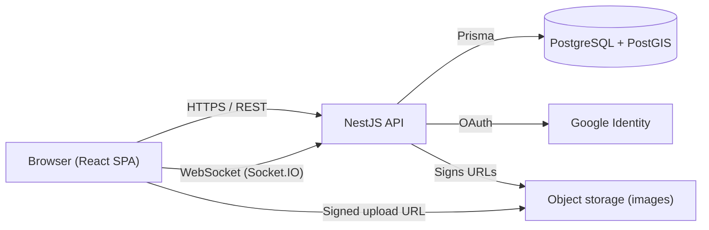

# Architecture overview

## System context



## Stack

| Layer | Choice | ADR |
|---|---|---|
| Repository | pnpm workspaces + Turborepo monorepo | [0001](../decisions/0001-monorepo-pnpm-turborepo.md) |
| Backend | NestJS (modular monolith) | [0002](../decisions/0002-nestjs-prisma-postgresql.md) |
| ORM | Prisma (raw SQL for PostGIS queries) | [0002](../decisions/0002-nestjs-prisma-postgresql.md) |
| Database | PostgreSQL + PostGIS | [0002](../decisions/0002-nestjs-prisma-postgresql.md) |
| Validation | Zod, shared between web and api (`nestjs-zod`) | [0003](../decisions/0003-shared-zod-validation.md) |
| Frontend | React + TypeScript + Vite, React Router | — |
| Frontend state | TanStack Query (server state) + Zustand (client state) | [0004](../decisions/0004-tanstack-query-zustand.md) |
| Forms | React Hook Form + Zod resolver | — |
| Styling | Tailwind CSS + shadcn/ui | — |
| Auth | Google OAuth (Passport) + JWT access/refresh in httpOnly cookies | [0006](../decisions/0006-auth-google-jwt-cookies.md) |
| Real time | Socket.IO through a NestJS gateway | — |
| Images | Cloudflare R2 (private bucket), compressed in the browser, uploaded and read with presigned URLs | [0010](../decisions/0010-image-storage-r2.md) |
| Geocoding | Georef (Argentine government API), called from the API | [0009](../decisions/0009-geocoding-georef.md) |
| API docs | Swagger / OpenAPI (`@nestjs/swagger`) | — |
| Logging | pino | — |
| Hosting | Render (web static site + api), Neon (database) | [0005](../decisions/0005-free-tier-hosting.md) |
| Testing | Jest + Supertest, API only for now | [0008](../decisions/0008-api-only-testing-first.md) |

## Repository layout

```
.
├── CLAUDE.md
├── README.md
├── docker-compose.yml         # local Postgres + PostGIS
├── turbo.json
├── pnpm-workspace.yaml
├── .claude/commands/          # SDD slash commands for Claude Code
├── .github/workflows/         # CI/CD
├── apps/
│   ├── api/                   # NestJS  (@sm/api)
│   └── web/                   # React   (@sm/web)
├── packages/
│   ├── config/                # shared eslint / tsconfig / prettier (@sm/config)
│   └── shared/                # Zod schemas, types, enums, constants (@sm/shared)
└── docs/
```

## Backend modules

One NestJS module per domain. Controllers only receive, validate and delegate; business rules live in services; authorization lives in guards.

```
apps/api/src/
├── appointments/    request, accept/reject, cancel, complete
├── auth/            Google OAuth, JWT, session refresh
├── categories/
├── chat/            WebSocket gateway + conversations/messages
├── common/          guards, filters, pipes, interceptors, decorators
├── config/          environment schema (Zod) and typed config
├── favorites/
├── notifications/
├── prisma/          PrismaService
├── professionals/   profile, categories, availability, geo search
├── properties/      client addresses
├── reviews/
├── uploads/         signed URLs
└── users/
```

Inside a module:

```
appointments/
├── appointments.controller.ts
├── appointments.module.ts
├── appointments.service.spec.ts     # unit tests
├── appointments.service.ts
├── dto/                             # classes created from @sm/shared Zod schemas
└── guards/                          # e.g. AppointmentParticipantGuard
```

## Frontend structure

Feature-based, not type-based:

```
apps/web/src/
├── app/             router, providers, layout
├── components/ui/        # shadcn/ui
├── features/
│   ├── appointments/
│   ├── auth/
│   ├── chat/
│   ├── notifications/
│   ├── professionals/
│   ├── reviews/
│   ├── search/
│   └── settings/
│       ├── api/          # TanStack Query hooks (useXQuery / useXMutation)
│       ├── components/
│       ├── pages/
│       └── store.ts      # Zustand slice, only if needed
├── lib/                  # api client, socket client, utils
└── stores/               # global Zustand stores (session, active mode)
```

## Cross-cutting decisions

- **Shared contract:** request/response schemas live in `@sm/shared`; the frontend never redefines API types.
- **Single users table:** client and professional are the same `users` row; a `professional_profiles` row makes someone a professional. ([0007](../decisions/0007-single-users-table.md))
- **Denormalized rating:** `rating_avg` / `rating_count` on `professional_profiles`, updated in the same transaction as the review.
- **Geospatial:** `geography(Point, 4326)` columns with GIST indexes; proximity via `ST_DWithin` / `ST_Distance` in raw queries.
- **Time:** all timestamps `timestamptz` in UTC; availability uses `time` plus the professional's `timezone`.

## Open questions

None for now.
