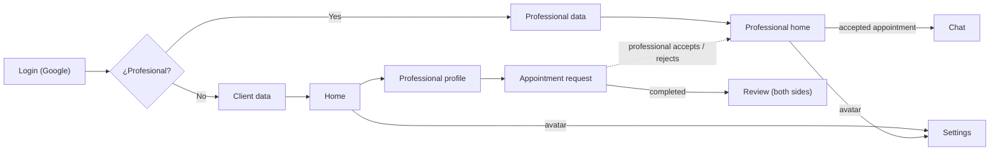

# User flows

Original diagram: [`../diagrams/app-flow.excalidraw.png`](../diagrams/app-flow.excalidraw.png) (editable in Excalidraw: the scene is embedded in the PNG). This document is the text version that specs reference.

## Overview

## Screens

### Login
- Sign in with Google. → `FR-AUTH-01`

### Onboarding decision
- "¿Sos profesional?" → client or professional onboarding. → `FR-AUTH-02`

### Client data
- First name, last name, address, phone, photo. → `FR-AUTH-03`

### Professional data
- First name, last name, address, phone, photo.
- Categories (multiple): gas fitter, plumber, electrician, painter, carpenter, roofer.
- Available days and hours (default Mon–Fri 08:00–16:00, editable per day).
- License number (required for gas fitters).
→ `FR-AUTH-04`, `BR-05`, `BR-10`

### Home (client)
- List of professionals.
- Filters: category, rating, proximity.
- Search by first or last name (from 2 characters, 300 ms debounce).
- Favorites.
- Avatar → Settings.
→ `FR-SRCH-*`, `FR-FAV-*`

### Professional profile
- Professional's data; check badge if licensed.
- "Request appointment" action.
→ `FR-PROF-01`, `FR-PROF-02`

### Appointment request
- Date, time, description, up to 3 images.
→ `FR-APPT-01`, `BR-07`

### Professional home
- Pending jobs (accept / reject).
- Recently completed jobs.
- Agenda.
- Avatar → Settings.
→ `FR-APPT-02`, `FR-APPT-05`

### Chat
- Opened by an accepted appointment. Messages with date and time.
→ `FR-CHAT-*`, `BR-09`

### Review
- After the appointment, both parties can review each other: stars, comment, up to 3 images.
- A notification tells each party they can review.
→ `FR-REV-*`, `FR-NOTIF-01`, `BR-08`

### Settings
- Edit personal data, manage addresses, sign out.
→ `FR-SET-*`, `FR-AUTH-05`
